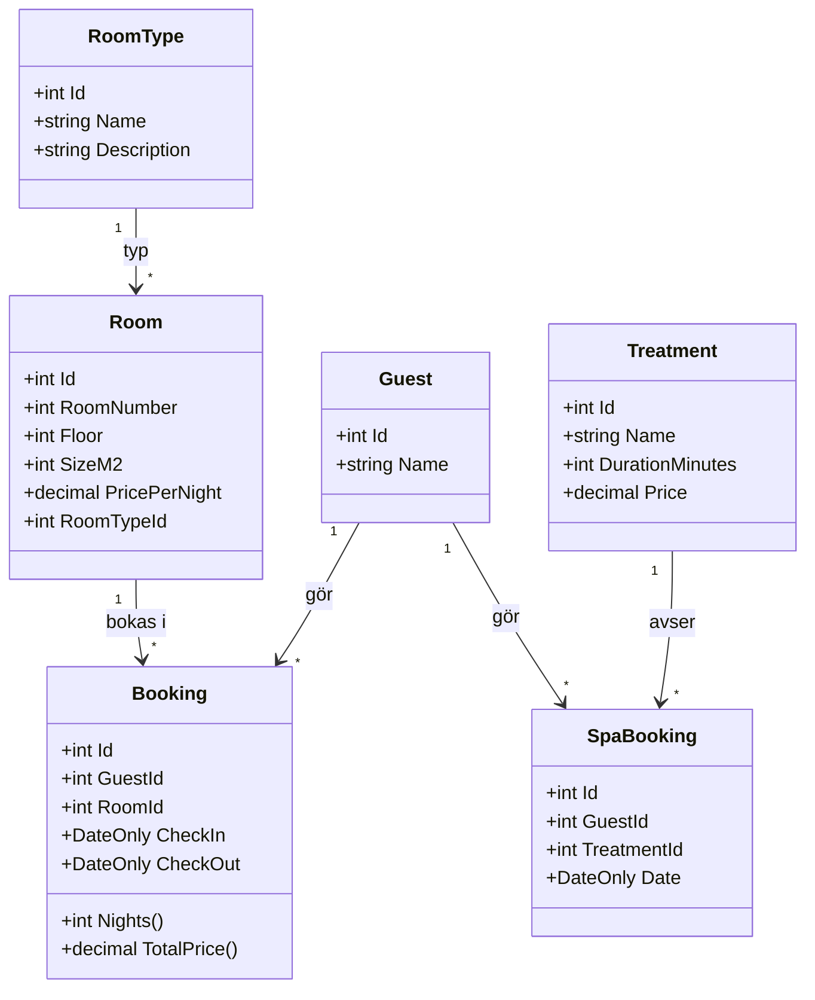

# Hotel Grandioso — Inlämning 1

**Namn:** Martin Bäcklund

## Så kör du projektet

1. Forka repot på GitHub och klona din fork
2. Öppna `HotelGrandioso.slnx` i Visual Studio (eller öppna mappen i VS Code)
3. Tryck **F5** för att starta

Via terminalen:

```bash
dotnet run --project HotelGrandioso
```

## Databas

- Databas: SQLite hotel.db
Connectionstring läses från miljövariabeln "HOTEL_DB", finns i Properties/launchSettings.json.
- Migrationer: Migrationer ligger i HotelGrandioso/Migrations/
De körs automatiskt när programmet startar via "context.Database.Migrate(), så databasen skapas av sig själv.

## UML-klassdiagram



- `Booking` och `SpaBooking` är kopplingstabeller: en gäst kan ha många bokningar, ett rum kan bokas många gånger (men aldrig för överlappande datum).
- `RoomType` är en egen entitet så att typnamn och beskrivning bara finns på ett ställe.
- Pris räknas ut i `Booking` (`Nights() × Room.PricePerNight`) och sparas inte, så det kan aldrig bli inaktuellt.
- `Guest` saknar `HairColor`, `HeightCm` och `Religion` med avsikt, se GDPR nedan.

## GDPR

Utvärdera fälten i `Guest` ett i taget. Vad bygger du in, och varför?

>Jag valde att endast bygga in relevant och nödvändig information. Vad för hårfärg, längd och religonstillhörighet är irellevant för projektets ändamål. Religon anses också vara en känslig uppgift och kräver uttryckligt samtycke samt extra skydd. Name var den enda relevanta då hotellet måste veta vem bokningen tillhör.

## Designmönster

Beskriv det designmönster du använt (till exempel Repository), vad det gör och varför du valde det.

>Jag har använt mig av repository mönstret. All kod som pratar med databasen ligger i BookingRepository. Klassen har metoder som AddBooking, CancelBooking, GetFreeRooms och IsBooked. Ingen annan del i programmet använder HotelContext direkt. IBookingRepository beskriver vad som går att göra, inte hur det ska göras. Varje klass har ett tydligt anvsar; menu sköter inmatning och usktrift, BookingRepository sköter databasen och modellerna innehåller endast data och enkel logik.

## Tekniker

- C# / .NET 10
- Entity Framework Core
